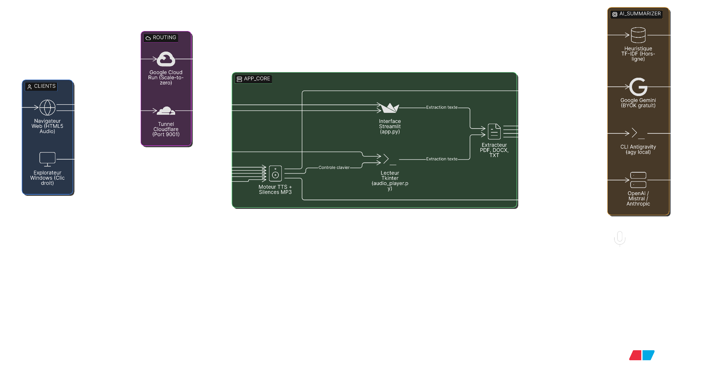
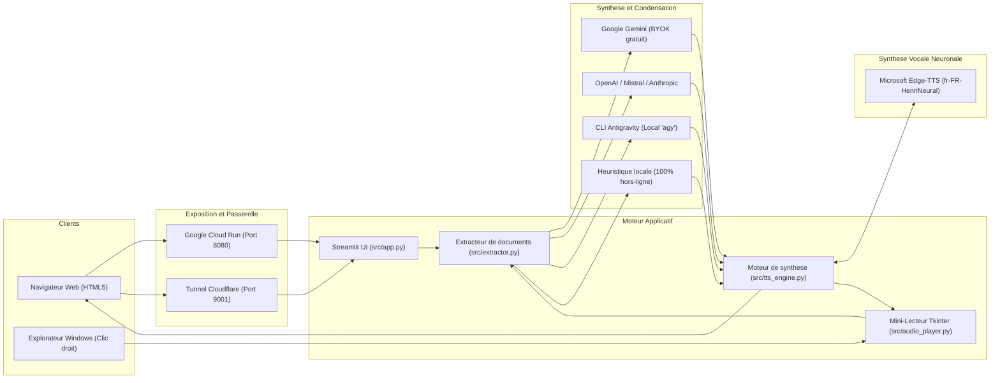

# Text2Speech: lecteur vocal accessible

Application d'assistance a la lecture concue pour les personnes eprouvant des difficultes de dechiffrage ou de concentration visuelle (fatigue cognitive, troubles de l'attention, dyslexie). Le systeme transforme n'importe quel document depose en un flux audio naturel et intelligible, pilote en direct a la cadence souhaitee.

L'application est disponible en ligne sur https://text2speech-948219637422.europe-west1.run.app

L'outil offre deux modes d'interaction: une interface web Streamlit ergonomique (en ligne ou en local) et une commande directe par clic droit dans l'explorateur Windows.

## Fonctionnalites

### Trois modalites de restitution sonore
L'utilisateur selectionne son niveau d'information d'un simple clic:
- Synthese eclair (< 1 minute): formulation orale courte structuree en trois volets (objet du document, apports majeurs, synthese operationnelle et actions).
- Resume a 50 %: contraction de moitie conservant la trame logique et les faits saillants.
- Lecture integrale: vocalisation complete et nettoyee du texte d'origine.

### Moteur de condensation multi-fournisseur
La phase de resume s'adapte a vos ressources:
- CLI Antigravity (Local & sans cle): exploite la session locale deja authentifiee sur votre machine via le binaire `agy`.
- Mode BYOK (Bring Your Own Key): integration directe des cles API personnelles pour Google Gemini (cle gratuite via Google AI Studio), OpenAI, Mistral AI ou Anthropic.
- Heuristique autonome: algorithme deterministe d'extraction lexicale fonctionnant a 100 % hors-ligne sans aucune dependance a une IA externe.

### Voix naturelle et gestion des silences
- Restitution par voix neuronales francaises de qualite studio (voix masculine Henri par defaut, Denise, Vivienne, Remy).
- Reglage de la pause inter-phrases (de 0.2s a 2.5s) grace a l'injection de trames de silence MPEG Layer III sans distorsion.
- Acceleration instantanee en direct: le curseur de vitesse et les boutons rapides (0.85x, 1.0x, 1.2x, 1.5x) modifient la cadence dans le navigateur en cours d'ecoute, avec zero latence et sans re-generation audio.

### Integration au menu contextuel Windows
Un clic droit sur un fichier `.pdf`, `.docx`, `.txt` ou `.md` dans l'explorateur Windows permet de lancer aussitot un mini-lecteur flottant (380x190px) au premier plan, avec controle au clavier (barre d'espace pour Pause/Reprendre, Echap pour fermer).

### Partage distant par tunnel Cloudflare
Exposition instantanee de l'application sur le port 9001 via un lien public chiffre en `https://...trycloudflare.com`, sans manipulation de pare-feu ni redirection de ports.

## Prerequis

- Windows 10 ou 11
- Python 3.12 (ou gestionnaire `uv`)
- Connexion internet pour le streaming vocal Edge-TTS et le tunnel Cloudflare

## Installation

Dans un terminal PowerShell a la racine du projet:

```powershell
# Creation de l'environnement virtuel et installation des dependances
uv venv .venv --python py
uv pip install --python .venv -r requirements.txt
```

Si le fichier `requirements.txt` n'est pas encore genere, installez directement les paquets de base:

```powershell
uv pip install --python .venv streamlit edge-tts pypdf python-docx pygame pytest requests
```

Pour activer le menu contextuel Windows (clic droit):

```powershell
powershell -ExecutionPolicy Bypass -File scripts\register_context_menu.ps1
```

## Utilisation

### Lancement de l'interface Web (port 9001)

En double-cliquant sur le fichier `launch.bat` ou via PowerShell:

```powershell
.\start_app.ps1
```

L'application s'ouvre a l'adresse locale: `http://localhost:9001`.

### Partage distant securise

Pour partager l'application vers un smartphone ou un poste distant:

1. Lancez d'abord le serveur local via `launch.bat`.
2. Double-cliquez sur `partager.bat`.
3. Le terminal affiche l'adresse publique securisee du type `https://xxxx.trycloudflare.com`.

### Deploiement serverless Google Cloud Run (Scale-to-Zero)

Pour heberger l'application sur Google Cloud Run avec extinction automatique hors usage:

```powershell
.\deploy_cloud_run.ps1 -Project "VOTRE_PROJET_GCP" -Region "europe-west1"
```

Le parametre `--min-instances 0` garantit que l'application ne consomme aucune ressource et n'engendre aucun cout lorsqu'elle n'est pas sollicitee. Dès qu'un utilisateur ouvre l'URL publique HTTPS fournie par Google, Cloud Run reveille l'instance en quelques secondes pour traiter la session.

### Ligne de commande CLI

Le moteur peut etre appele directement pour automatiser la synthese d'un fichier:

```powershell
.venv\Scripts\python -m src.cli --file "mon_document.pdf" --mode condense --gui
```

Arguments disponibles:
- `--file` ou `-f`: chemin du document (.pdf, .docx, .txt, .md).
- `--mode` ou `-m`: `condense`, `summary_50`, ou `full` (defaut: `condense`).
- `--speed` ou `-s`: vitesse d'elocution (de 0.75 a 1.75).
- `--voice` ou `-v`: voix cible (defaut: `fr-FR-HenriNeural`).
- `--gui`: ouvre le mini-lecteur interactif.
- `--play`: lit directement l'audio dans le terminal.
- `--out` ou `-o`: chemin du fichier MP3 produit.

## Architecture systeme



### Schema Eraser (Diagram-as-Code)

Le rendu visuel ci-dessus a ete genere via l'API Eraser avec fond transparent. Le fichier source est disponible dans [docs/architecture.eraser](file:///C:/Users/Admin/Desktop/servitudes/text2speech/docs/architecture.eraser). Vous pouvez le coller directement dans l'editeur [Eraser.io](https://app.eraser.io) (mode Diagram-as-Code) pour modifier visuellement les composants.

```eraser
// Text2Speech - Architecture globale (Eraser DSL)
typeface clean
colorMode bold
direction right

Clients [color: blue, icon: user] {
  Navigateur Web [icon: globe, label: "Navigateur Web (HTML5 Audio)"]
  Windows Explorer [icon: monitor, label: "Explorateur Windows (Clic droit)"]
}

Routing [color: purple, icon: cloud] {
  Cloud Run Ingress [icon: google-cloud, label: "Google Cloud Run (HTTPS :8080)"]
  Cloudflare Tunnel [icon: cloudflare, label: "Tunnel Cloudflare (localhost:9001)"]
}

App Container [color: green, icon: server] {
  Streamlit UI [icon: streamlit, label: "Interface Streamlit (app.py)"]
  Mini Player [icon: terminal, label: "Lecteur Tkinter / CLI (launcher.py)"]
  Doc Extractor [icon: file-text, label: "Extracteur (pypdf, python-docx)"]
  TTS Engine [icon: speaker, label: "Moteur TTS (Edge-TTS + Silences MP3)"]
}

AI Providers [color: orange, icon: cpu] {
  Gemini [icon: google, label: "Google Gemini (BYOK gratuit)"]
  OpenAI Mistral [icon: server, label: "OpenAI / Mistral / Anthropic"]
  Antigravity CLI [icon: terminal, label: "Antigravity CLI (agy local)"]
  Local Fallback [icon: database, label: "Heuristique TF-IDF (100% Hors-ligne)"]
}

Edge TTS Service [icon: mic, label: "Microsoft Neural Edge-TTS (fr-FR-HenriNeural)"]

Navigateur Web > Cloud Run Ingress: Requete HTTPS
Navigateur Web > Cloudflare Tunnel: Requete distante
Windows Explorer > Mini Player: Lancement direct

Cloud Run Ingress > Streamlit UI
Cloudflare Tunnel > Streamlit UI

Streamlit UI > Doc Extractor: Extraction texte brut
Mini Player > Doc Extractor: Extraction texte brut

Doc Extractor > Gemini: Resume condense (Cle API)
Doc Extractor > OpenAI Mistral: Resume condense (Cle API)
Doc Extractor > Antigravity CLI: Resume condense (Local)
Doc Extractor > Local Fallback: Extraction frequencielle

Gemini > TTS Engine: Texte condense
OpenAI Mistral > TTS Engine: Texte condense
Antigravity CLI > TTS Engine: Texte condense
Local Fallback > TTS Engine: Texte nettoye

TTS Engine > Edge TTS Service: Streaming audio neuronal
Edge TTS Service > TTS Engine: Flux MP3 24kHz

TTS Engine > Navigateur Web: Restitution audio avec playbackRate direct
TTS Engine > Mini Player: Restitution audio avec controle clavier
```

### Vue textuelle fonctionnelle



## Structure des fichiers du projet

```
text2speech/
├── src/
│   ├── extractor.py       # Extraction documentaire (PDF, DOCX, TXT) et nettoyage
│   ├── summarizer.py      # Condensation de texte (IA multi-fournisseur & heuristique)
│   ├── tts_engine.py      # Synthese vocale neuronale et silences inter-phrases
│   ├── audio_player.py    # Mini-lecteur de bureau avec raccourcis clavier
│   ├── ai_bridge.py       # Passerelle CLI Antigravity locale et API BYOK
│   ├── cli.py             # Point d'entree unifie en ligne de commande
│   └── app.py             # Application Web Streamlit accessible
├── scripts/
│   ├── register_context_menu.ps1    # Inscription dans le registre Windows (HKCU)
│   └── unregister_context_menu.ps1  # Nettoyage et desinstallation du registre
├── tests/
│   ├── test_extractor.py  # Validation de l'ingestion documentaire
│   ├── test_summarizer.py # Validation des formats de condensation
│   ├── test_tts.py        # Validation de la generation sonore et debit
│   ├── test_cli.py        # Validation de l'interface en ligne de commande
│   └── test_ai_bridge.py  # Validation des passerelles IA et gestion des cles
├── launch.bat             # Lanceur Windows du serveur Streamlit sur le port 9001
├── partager.bat           # Lanceur Windows du tunnel distant Cloudflare
├── start_app.ps1          # Script PowerShell de demarrage serveur
├── launcher.py            # Point de liaison transparent pour le clic droit
├── pyproject.toml         # Configuration du projet et regles pytest
├── prd.md                 # Document d'exigences produit (discipline BMad PRD)
├── DESIGN.md              # Specification visuelle et tokens (standard Google Labs)
└── EXPERIENCE.md          # Architecture d'interaction et accessibilite socle
```

## Validation par les tests

Pour executer la suite complete des dix-sept tests unitaires:

```powershell
.venv\Scripts\pytest tests/ -v
```

## Desinstallation du clic droit Windows

Pour retirer l'entree "Ecouter ce document" du menu contextuel sans laisser de residu dans la base de registre:

```powershell
powershell -ExecutionPolicy Bypass -File scripts\unregister_context_menu.ps1
```
